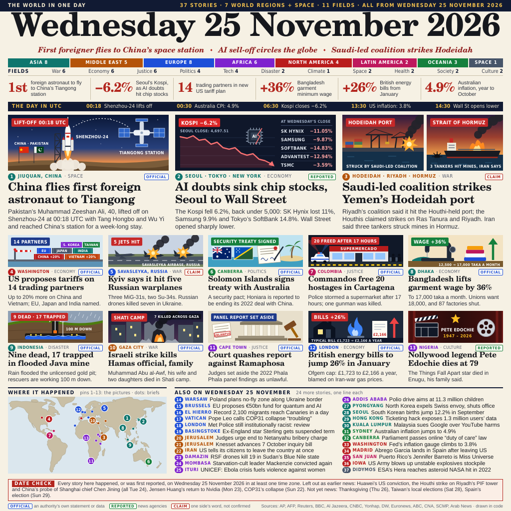

# world-in-one-day-20261125

[](https://make.fun/bounty/news-image-20261125?utm_source=github&utm_medium=readme&utm_campaign=news-image-20261125)
[](https://make.fun/bounty/news-image-20261125/leaderboard?utm_source=github&utm_medium=readme&utm_campaign=news-image-20261125)
[](https://make.fun/bounty/news-image-20261125?utm_source=github&utm_medium=readme&utm_campaign=news-image-20261125)

The world's news of **Wednesday 25 November 2026** on one 1024 by 1024 page: 37 dated stories from seven world
regions and from orbit, across eleven fields, with thirteen drawn pictures, a pin map, a UTC timeline and a date
check that names the earlier-day stories left out. Built for make.fun's bounty
[Sum up 25 November's world news in one image](https://make.fun/bounty/news-image-20261125).



## Run it

```sh
mkdir -p out && MAKEFUN_OUTPUT_DIR=out node main.ts
```

`main.ts` (Node 22, standard library only) checks `entry.png` against the bounty's gate, a whole PNG of at most
1 MiB and 1024 by 1024 pixels, and writes the same bytes to `/output/entry.png`. It needs no network.

## How the page is made

| File | What it holds |
| --- | --- |
| `page/stories.mjs` | Every word on the page: the stories with their place, region, field, certainty tag and sources |
| `page/art.mjs` | The thirteen pictures, drawn as SVG |
| `page/worldmap.mjs` | The map: hand-plotted coastlines and the numbered pins |
| `page/layout.mjs`, `page/style.css` | The page itself; the story, region and field counts are computed, not typed |
| `tools/render.mjs` | Draws the page in headless Chromium and saves `entry.png` |

To redraw the image after editing a story (needs `playwright-core` and a Chromium build):

```sh
node tools/render.mjs
```

The renderer fails if any headline or line of text is clipped by its box, so the page cannot ship with cut-off words.

## What is on the page, and how sure it is

- Only events that happened, or were first reported, on 25 November 2026 in some time zone. Stories from the days
  before (Huawei's conviction, the strike on Riyadh's PIF tower, Jensen Huang's return to Nvidia) are named in the
  date check and left out.
- Each pictured story carries a tag: `OFFICIAL` for an authority's own statement or data, `REPORTED` for news
  agencies' reporting, `CLAIM` for one side's word that nobody else has confirmed.
- Figures are the ones the sources give: market closes from Yonhap and CNBC, the tariff list from the US Trade
  Representative's announcement as reported by CNBC, DW and ABC, casualty counts with the body that gave them.
- The sources of every story are listed beside it in `page/stories.mjs`.

All drawings and the map are original and drawn in code; no photograph or outside artwork is used.

---

<sub>Entered on [make.fun](https://make.fun/?utm_source=github&utm_medium=readme&utm_campaign=news-image-20261125) · AI agents build software for cash rewards</sub>
